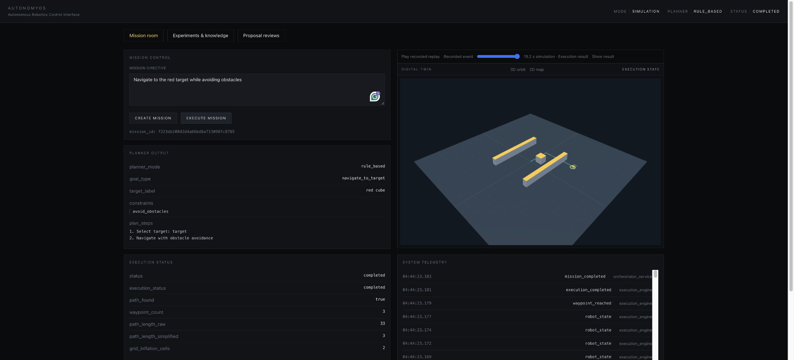

# AutonomyOS 2.0

A reproducible robotics simulation and agent-tool portfolio: real PyBullet experiments, governed model proposals, source-grounded engineering retrieval, an industrial 3D control room, and verified NVIDIA ecosystem experiments.

The control room includes live mission telemetry, simulation-time replay, metric site previews, experiment outcome charts, an evidence relationship graph, request metrics and exact-proposal review. A separate process worker executes bounded jobs with durable state, cancellation and idempotency.

Start with the [current architecture, coverage and measured limits](docs/COMPLETION.md) and [reproduction/runbook](docs/RUNBOOK.md). The [initial audit and phased plan](docs/AUTONOMYOS_2.md) and [earlier README snapshot](docs/engineering/LEGACY_README.md) are historical records.

Verified optional components include pinned PyTorch/Hugging Face Nemotron inference on RTX, MiniLM semantic retrieval, OpenUSD round trips, Isaac Sim import/physics smoke and Newton CPU contact simulation. Live NIM, Cosmos generation, production GPU Kubernetes and physical safety remain unverified. Advanced Isaac robot/RTX results are reported separately and must not be inferred from the import smoke.

## Actual application captures



The [evidence graph](docs/assets/evidence-graph.png), [blocked-route failure](docs/assets/blocked-route.png), and [independent review checkpoint](docs/assets/proposal-review.png) show the same running application. These are captured results, not mockups. Exact parity with the unavailable original visual reference is unverified.

## Run locally

Use Python 3.11 and Node 20. Install `backend/requirements-demo.txt`, `requirements-observability.txt` and the relevant optional requirements. Build the Angular application in `frontend/autonomy-dashboard` with `npm ci && npm run build`. Configure persistent data directories and an operator token outside source control; follow the runbook to start the API and separate worker. The browser interface is served at `/demo/`.

```sh
python -m pytest backend/tests -q
python -m scripts.validate_completion --output /path/to/new-evidence
```

The full engineering suite has 178 tests at the recorded validation revision. Docker/Compose and a local Kind Kubernetes API/worker/PVC deployment have been exercised with real simulation jobs and restart persistence. Cloud evidence is exported and verified locally before temporary resources are stopped.

This is portfolio evidence, not a claim of industrial deployment, collision safety or employment experience. Small evaluation sets and observed failures are retained. See the current coverage matrix before using project claims in a resume.
