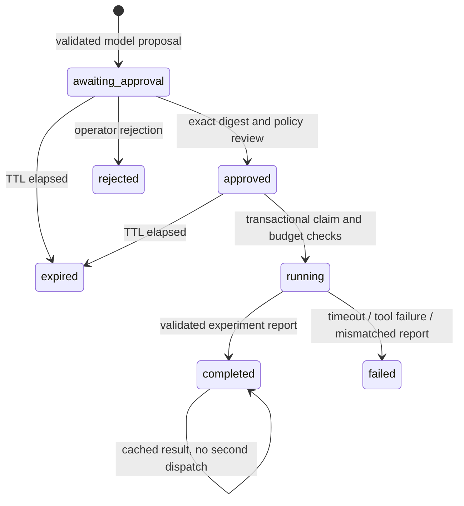

# Governed model-to-experiment workflow

A pinned model proposes an `ExperimentRequest`. The experiment control plane imports
its raw output and checks it again, records model/revision/source SHA and reported
tokens, freezes a policy snapshot, and waits for an exact proposal/policy digest to
be approved by a local operator. The model's interface does not include approval,
arbitrary shell commands or output destinations.



`backend/experiments/agent_workflow.py` owns an independent SQLite journal, not the
mission/telemetry database being developed on `phase-2-ai`. It persists approval,
policy, state, tool-call count and ordered decisions. Claiming an approved workflow
uses a SQLite write transaction so concurrent callers cannot dispatch it twice.
After process interruption, `running` remains visible and is not automatically
retried; this prevents silently repeating an uncertain external effect. Operator
reconciliation for interrupted runs remains a future feature.

The one permitted tool runs the existing experiment service in a child process,
without a shell. Scenario and recorded-token budgets, approval expiry, tool-call
count and timeout are enforced. A timed-out process group is terminated. A completed
report must match the approved request and pass its independent evaluation. Completed
calls return the recorded result; failed calls require a new reviewed proposal.
This is at-most-once automatic dispatch per workflow, not a distributed exactly-once
guarantee.

The default policy requires human review. Operator usage, from the repository root:

```sh
python -m scripts.agent_workflow --root artifacts/agent submit artifacts/inference.json
python -m scripts.agent_workflow --root artifacts/agent show WORKFLOW_ID
python -m scripts.agent_workflow --root artifacts/agent approve WORKFLOW_ID --digest EXACT_DIGEST --reviewer YOUR_NAME
python -m scripts.agent_workflow --root artifacts/agent execute WORKFLOW_ID
```

Review the `body`, `policy` and `digest` before approving. Changes to either the
proposal or policy invalidate approval. Reject instead of approving when the plan
is unsuitable. The CLI is a trusted local operator boundary: reviewer names are
self-declared, not authenticated identities, and importing a report does not
independently meter its token counts. Do not expose this as a multi-user service
without authentication and authorization. The source hash ties a proposal to the
imported evidence, not to a cryptographic attestation of remote model execution.

For a repeatable diagnostic using a real GPU-generated inference report:

```sh
python -m scripts.run_governed_demo --inference /path/to/verified-gpu-evidence/inference.json --output artifacts/governed-demo
```

This diagnostic explicitly uses `automated_validation` review under a separate test
policy. It proves the default policy rejects that kind of review, unapproved execution
is blocked, a mismatched digest is rejected, state survives reconstruction, the real
simulator tool executes once, and re-execution returns its saved result. It does not
claim that a human approved the diagnostic proposal. The summary, source inference,
SQLite state, request, tool log and experiment/replay traces remain on disk.

Scope is a governed workflow around one model planner and deterministic engineering
tools. It does not establish autonomous multi-LLM collaboration, NIM serving, robust
behavior against every adversarial prompt, distributed scheduling or production
adoption. Next gates include model-level adversarial prompt evaluation, interruption
reconciliation, authenticated review APIs and held-out engineering retrieval/tuning.
