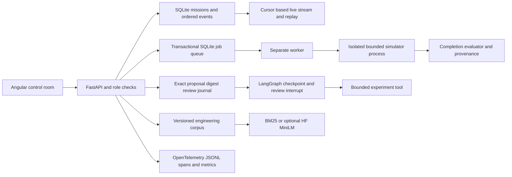

# AutonomyOS 2.0 delivery and evidence boundaries

This is a working portfolio system for simulation automation, with measured local and rented-hardware validation. It does not establish production adoption, physical safety, employment experience or general-purpose autonomous intelligence. Historical phase documents retain their original measurements; this page supersedes their planned-work status.

## Implemented architecture

The model proposes a typed experiment. The policy and reviewer authorize its exact digest; deterministic tools run the experiment and evaluate the outcome. LangGraph interruption cannot grant approval. Saved inference records preserve the model revision and generation metadata; importing a record is not a new inference call. The default human-review policy stays paused until separately reviewed. Automated validation uses a distinct, explicitly labeled policy.

Private operators have read, review, execute and manage permissions. Configured individual accounts bind review identity to a server-side subject; the local shared-token mode identifies only a local operator. Tokens stay out of journals. This is a single-workspace design, without OIDC or external identity attestation.

Jobs run in separate processes, with atomic claims, input-bound idempotency, cancellation, a parent timeout and a child watchdog. Only two jobs may be active. Stale running jobs become interrupted rather than silently retried. A failed completion evaluation is terminal `evaluation_failed`, not a successful job. API mission execution is serialized because the original simulator uses a default client.

## Requirement coverage

| Target theme | Delivered evidence | Scope boundary |
|---|---|---|
| Python and simulation engineering | Typed FastAPI, real PyBullet navigation/execution, metric site import | Kinematic reference robot, no collision-safety certification |
| Agent orchestration | Actual LangGraph durable checkpoints, review interrupt and bounded tool dispatch | A governed model/tool workflow, not a society of reasoning agents |
| Tool use and governance | Exact-digest approvals, budgets, at-most-once result reuse, audit events | No arbitrary code or shell tool |
| Simulation automation | Seeded manifests, isolated queue workers, success and blocked-route cases | Small bounded scenes; no industrial digital-twin fidelity claim |
| Evaluation and reproducibility | Semantic outcome hashes, repeat runs, negative gates, raw per-case records | 99/100 on the archived seed-42 baseline; retain its failure |
| Controller tuning | Locked train/validation/held-out protocol; 28/30 held out | Existing 8,000-step baseline selected; zero measured improvement |
| Knowledge retrieval | Versioned corpus, exact line/hash quotes, abstention | Extractive answers, not generated engineering advice |
| Semantic/vector retrieval | Real pinned HF MiniLM/PyTorch embeddings, 59 chunks | Eight implementer-labeled smoke queries; no broad accuracy claim |
| Model inference | Real pinned NVIDIA Nemotron HF inference on RTX | 3/3 small planning prompts, not general reliability |
| NVIDIA NIM | Structured compatible adapter and contract tests | Live NIM serving remains unverified without endpoint/access |
| NeMo | Nemotron model use | No NeMo training/fine-tuning validation |
| OpenUSD/Omniverse | Metric Z-up scene export, dimensions and round trip | Geometry interchange alone is not robot control |
| Isaac Sim | Real Jetbot lane goal, 2,489 steps, 0.397 m error; two hash-verified RTX frames | One bounded case, default physics; [separate full record](ISAAC_ROBOT_VALIDATION.md) |
| Newton | Real Newton 1.7/Warp CPU XPBD contact smoke, 480 steps | CPU contact only, no GPU robot claim |
| Multimodal perception | Twelve real RGB/segmentation-truth cases | Fixed red-color baseline, distractor failures retained; no learned detector claim |
| Cosmos/world models | Documented optional boundary | Gated model/license/access unavailable; no generated-world claim |
| Observability | Real OTel request spans, trace IDs, durations, denials and failures | Local JSONL exporter, not a hosted observability platform |
| Containers and CI | Built runtime images, real API/worker/restart smoke, branch CI | Small reference workloads |
| Kubernetes | Actual local Kind ARM64 API/worker/PVC/restart validation | No CoreWeave or multi-node GPU-cluster claim |
| Cloud deployment | Paid RTX runs with exact versions and local archive receipts | Temporary validation services are shut down after export |
| Visualization | 3D/2D mission room, sim-time replay, site preview, outcome bars, evidence graph, review and metrics | Original reference image unavailable; exact visual parity unverified |
| Principal-level communication | Architecture decisions, threat model, operational runbook, transparent failures | Portfolio evidence cannot establish years or scope of professional leadership |

## Validation record

The final engineering source passed 178 backend tests and the Angular production build. The recovered CPU deployment archive independently verifies 168 tests, real HTTP execution, public-mode guards and persistence across restart at its exact earlier source revision `2e63030`; it is not relabeled as the final source. The original second GPU archive independently verifies all 35 files and all 13 stages. The later complete 66-file GPU archive verifies a 176-test CPU deployment at its exact source, plus a separate final Isaac robot/camera source. All cloud pods are stopped after local verification. The final local 100-case runs each completed 99/100 with exact source/scenario/outcome reproduction; the failure remains in both reports. Each archive's receipt, source snapshot and dependency versions are authoritative for that run.

The current corpus is `knowledge/engineering-v4.json`. MiniLM revision is `1110a243fdf4706b3f48f1d95db1a4f5529b4d41`. Nemotron revision is `54641c1611fcff44fa4865626462445e0a153fc7`. BM25 and semantic retrieval both score recall@3/MRR 1.0 on each four-query split of the same tiny dataset; no semantic improvement is claimed. Eight grounded-answer smoke cases passed exact-citation checks. A prior failed abbreviation case is retained and has a regression test.

The image baseline reaches IoU 1.0 on four original views and approximately 0.011–0.019 with red distractors. These failures demonstrate why color segmentation cannot substantiate learned perception. Newton's probe settles from 1.5 m to approximately 0.09998 m; it does not validate the navigation engine.

Python runtime dependency audit, including pip and setuptools in the final native container freeze, reported no known advisories for that tested set. NPM production audit reported zero; the full build-tool tree retained 21 moderate advisories and zero high/critical at the recorded audit time. Audit results are dated evidence, not a perpetual guarantee.

## Decisions and operations

See [the runbook](RUNBOOK.md), [the original audit](AUTONOMYOS_2.md), [workflow controls](AGENT_WORKFLOW.md), and [historical tuning measurements](KNOWLEDGE_AND_TUNING.md). Resume bullets may describe only the completed and explicitly scoped portfolio evidence above; user employment dates require their own source.
